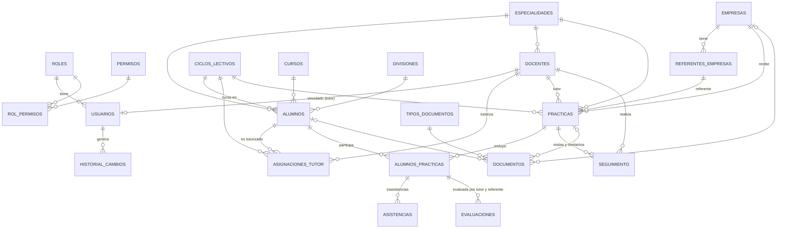

# Arquitectura del sistema de Prácticas Profesionalizantes

## 1. Visión general

Aplicación web monolítica, en capas, de servidor único. Es simple de instalar y operar en una escuela (un solo proceso, un solo archivo de base de datos) y está organizada para que cada módulo pueda evolucionar sin tocar a los demás.

```
 Navegador ──HTTPS──► Proxy inverso (nginx) ──► gunicorn / waitress ──► Flask (app/)
                                                                         │
        ┌────────────────────────────┬───────────────────────────────────┤
        │ views/ (rutas por módulo)  │ services.py (reglas de negocio)   │
        │ crud.py (CRUD declarativo) │ auth.py (sesión, roles, alcance)  │
        │ pdfs.py / charts.py        │ backup.py (respaldos)             │
        └────────────────────────────┴──────────────┬────────────────────┘
                                                    ▼
                                  SQLite (instance/practicas.db)  +  instance/uploads/
```

| Capa | Archivos | Responsabilidad |
|---|---|---|
| Presentación | `app/templates`, `app/static` | HTML (Jinja2), CSS institucional responsive, JS mínimo sin dependencias |
| Rutas | `app/views/*.py` | Un blueprint por módulo; validan entrada y delegan |
| CRUD genérico | `app/crud.py` | Clase `Entity`: listado, filtros, búsqueda sin acentos, paginación, alta, edición, baja lógica, restauración, exportación Excel, auditoría y validaciones. Los módulos sólo declaran campos y columnas |
| Reglas de negocio | `app/services.py` | Horas, avance, documentación completa, alertas, vacantes, numeración, evaluación y sincronización de estados |
| Seguridad | `app/auth.py` | Hash de claves, bloqueo, CSRF, permisos por rol, alcance de datos del tutor |
| Datos | `schema.sql`, `app/db.py`, `app/bootstrap.py` | Esquema normalizado, acceso, auditoría, datos base |
| Salidas | `app/pdfs.py`, `app/views/informes.py` | PDF (reportlab) y Excel (openpyxl) con encabezado institucional, fecha de emisión y filtros |

### Decisión de stack (y por qué)

El stack elegido es **Python 3 + Flask + SQLite + HTML/CSS/JS propios**. El entorno de construcción no tenía acceso a internet para instalar paquetes, por lo que se usó únicamente lo ya disponible (Flask, Jinja2, openpyxl, reportlab). Consecuencias:

- **Ventajas:** instalación en minutos, sin servicio de base de datos aparte, copia de seguridad = un ZIP, adecuado para el volumen de una escuela (miles de registros, pocos usuarios simultáneos).
- **Límites:** SQLite admite un único escritor a la vez (se usa modo WAL, suficiente para decenas de usuarios). Si la institución necesitara muchos usuarios concurrentes o varias sedes, conviene migrar a PostgreSQL (ver sección 6).
- Los gráficos son SVG generados en el servidor (sin librerías JS), lo que además permite incluirlos en informes.

## 2. Modelo de datos (diagrama entidad-relación)




Las tablas `configuracion` (clave/valor: datos de la escuela y parámetros) e `historial_cambios` (auditoría) completan el esquema. El DDL completo está en `schema.sql`.

### Relaciones clave

- **Alumno ⇄ Práctica (N:M) mediante `alumnos_practicas`.** Una práctica puede tener varios alumnos y un alumno puede tener varias prácticas a lo largo de los años. La tabla intermedia es la *unidad de avance*: guarda las horas requeridas del alumno, su estado, la calificación final y el resultado. Asistencias y evaluaciones cuelgan de ella, no de la práctica, porque cada alumno avanza y se califica por separado.
- **Empresa 1:N Práctica y Empresa 1:N Referentes.** La empresa se carga una sola vez y se reutiliza en todos los ciclos; el historial de la empresa es simplemente el conjunto de sus prácticas. Las vacantes se comparan contra los alumnos que ocupan una práctica no cerrada.
- **Docente ⇄ Alumno por ciclo (`asignaciones_tutor`).** Define el *alcance* de un tutor: sólo ve a los alumnos asignados (o los de las prácticas que tutoriza). El mismo docente se reutiliza entre ciclos.
- **Documentos con vínculos opcionales** (alumno, empresa y/o práctica) más el *ámbito* del tipo de documento: el tipo «Convenio» corresponde a una empresa, «Autorización de padres» a un alumno, «Plan de prácticas» a una práctica. El indicador de completitud se calcula comparando los tipos obligatorios con los documentos aprobados, según el ámbito.
- **Evaluaciones:** una por evaluador (Tutor / Referente) y por asignación, con seis criterios 1-10 y promedio. La nota final y el resultado se registran en `alumnos_practicas`.
- **Ciclos lectivos** parametrizan todo: alumnos, prácticas y asignaciones pertenecen a un ciclo; hay una función «Reutilizar en otro ciclo» que copia una práctica.

### Campos de control comunes

Toda tabla de negocio incluye `creado_en/por`, `modificado_en/por` y `eliminado_en/por`. La **baja es lógica**: nada se borra físicamente; los índices únicos son parciales (`WHERE eliminado_en IS NULL`) para poder reutilizar un DNI o legajo tras una baja. Cada alta, modificación, baja, restauración, descarga, exportación, copia de seguridad y cambio de permisos se registra en `historial_cambios` (usuario, fecha, IP, valores anteriores y nuevos).

## 3. Estados de una práctica

`Pendiente de asignación → En proceso de asignación → Documentación pendiente → Habilitada para comenzar → En curso → Finalizada → Aprobada / Desaprobada` (y `Suspendida`).

Reglas automáticas (en `services.py` y `views/practicas.py`):

1. Pasar a *Habilitada* o *En curso* exige documentación obligatoria completa y aprobada; el coordinador puede **forzar** la transición y queda auditado.
2. *Aprobada / Desaprobada* sólo se establecen desde el cierre en **Evaluaciones**, nunca a mano.
3. Aprobar exige las horas requeridas completas (salvo forzado y auditado) y nota ≥ nota mínima configurable.
4. Cuando todas las asignaciones de una práctica tienen resultado, la práctica refleja el resultado.
5. Al agregar alumnos se avisa si se supera la cantidad de vacantes de la empresa.

### Asistencia automática (v1.1)

Las horas no se cargan: se calculan (`services.calcular_horas`).

- Cada práctica define `dias_semana` (1 = lunes … 7 = domingo) y `horas_dia`.
- Para cada asignación, los días de práctica entre su fecha de inicio y la de finalización (fin real del alumno, fin real o fin estimado de la práctica; nunca después de hoy) suman la jornada. Sólo corren con la asignación «En curso» o posterior.
- La tabla `asistencias` guarda únicamente **inasistencias** (justificadas o injustificadas) con las horas a descontar. Horas cumplidas = horas programadas − horas descontadas.
- La tabla `dias_sin_actividad` excluye fechas: feriados y recesos generales, cierres de una práctica (`practica_id`) y suspensiones de un alumno (`alumno_practica_id`, que el sistema abre y cierra al cambiar el estado).
- `db.migrate()` actualiza una base anterior al iniciar la aplicación (y al restaurar un respaldo): agrega las columnas, da de baja lógica los registros «Presente» y hace que las ausencias previas descuenten la jornada completa.

## 4. Seguridad

| Amenaza | Medida |
|---|---|
| Robo de credenciales | Claves con hash scrypt (Werkzeug), política de 8+ caracteres con letras y números, cambio obligatorio en primer ingreso si se indica |
| Fuerza bruta | Bloqueo de la cuenta 15 min tras 5 intentos fallidos |
| Secuestro de sesión | Cookie `HttpOnly`, `SameSite=Lax`, `Secure` con HTTPS, `session.clear()` al ingresar, vencimiento por inactividad (2 h) y máximo (8 h) |
| CSRF | Token por sesión verificado en todo POST |
| Inyección SQL | Consultas parametrizadas en todo el código; los nombres de columnas/tablas provienen de definiciones internas, nunca del usuario |
| XSS | Autoescape de Jinja2 y cabecera CSP (`script-src 'self'`, sin JS en línea) |
| Clickjacking / sniffing | `X-Frame-Options: DENY`, `X-Content-Type-Options: nosniff`, `Cache-Control: no-store`, HSTS opcional |
| Acceso indebido | Permisos por módulo y acción verificados **en el servidor** (`perm_required`), más alcance por tutor en cada consulta y en cada ficha |
| Archivos maliciosos | Lista de extensiones permitidas, verificación de firma (magic bytes), nombre en disco aleatorio (uuid), límite de 15 MB, descarga sólo autenticada |
| Datos de menores | Menores de 18 años requieren responsable legal; los datos sólo son visibles según rol/alcance; toda exportación y descarga queda auditada |
| Pérdida de datos | Baja lógica, auditoría, respaldos ZIP (BD + documentos) con restauración confirmada y respaldo automático previo |

## 5. Estructura del proyecto

```
practicas-pp/
├── app/
│   ├── __init__.py      fábrica de la aplicación, cabeceras, errores
│   ├── auth.py          autenticación, roles, alcance
│   ├── crud.py          motor CRUD declarativo
│   ├── services.py      reglas de negocio y consultas centrales
│   ├── bootstrap.py     roles, permisos, catálogos base
│   ├── seed.py          datos de demostración
│   ├── backup.py        respaldos
│   ├── pdfs.py, charts.py, filters.py, db.py
│   ├── views/           alumnos, empresas, docentes, practicas, seguimiento,
│   │                    documentos, evaluaciones, informes, main, admin, catalogos
│   ├── templates/       plantillas Jinja2
│   └── static/          css / js
├── schema.sql           DDL completo
├── manage.py            init-db, create-admin, seed-demo, backup, run
├── wsgi.py              punto de entrada de producción
├── tests/test_app.py    30 pruebas de integración
└── docs/                documentación
```

## 6. Migración a PostgreSQL (si se necesita escalar)

El esquema usa SQL estándar. Pasos: (1) reemplazar `INTEGER PRIMARY KEY` por `GENERATED ... AS IDENTITY` y `datetime('now','localtime')` por `now()`; (2) los índices parciales `WHERE eliminado_en IS NULL` funcionan igual; (3) cambiar el módulo `app/db.py` por un conector `psycopg` (los `?` pasan a `%s`) y reemplazar la función `norm` (búsqueda sin acentos) por la extensión `unaccent`; (4) cargar los datos con `sqlite3 .dump` o un script de copia por tabla. El resto de la aplicación no cambia.

## 7. Mejoras incorporadas respecto del pedido

Alertas automáticas (documentación, vencimientos, ritmo de horas insuficiente, prácticas listas para cerrar); control documental por tipo con vencimientos; asistencia automática con carga de inasistencias en lote por práctica; validación de CUIT con dígito verificador; copia de una práctica a otro ciclo; búsqueda global sin acentos; importación con modo «solo validar»; restauración de registros dados de baja; matriz de permisos editable.
